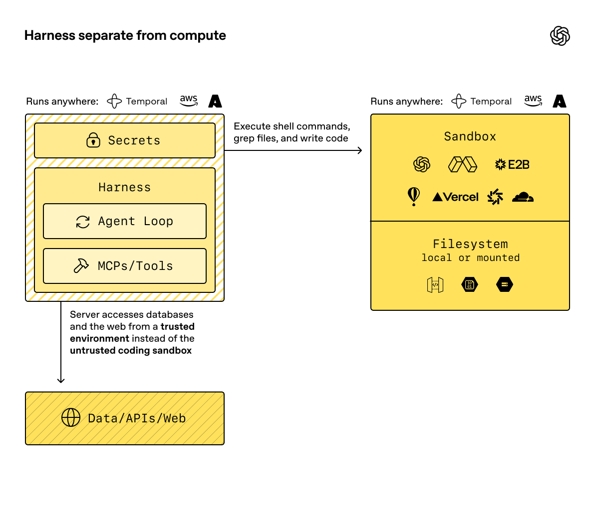

# openai-agent-substrate

[](LICENSE)
[](https://github.com/SatyKrish/openai-agent-substrate/actions/workflows/ci.yml)

A reference implementation of **Kubernetes as a sandbox compute provider for OpenAI Agents SDK `SandboxAgent`**, built on [Agent Substrate v1.0.0](https://github.com/agent-substrate/substrate/releases/tag/v1.0.0). The SDK harness runs in your trusted application. Shell commands and workspace files run in an Actor scheduled onto a Substrate worker.

## Harness separate from compute

This project follows the [harness separate from compute pattern](https://developers.openai.com/api/docs/guides/agents/sandboxes) in the official OpenAI Sandbox Agents guide.



*Diagram from the [official OpenAI documentation](https://developers.openai.com/api/docs/guides/agents/sandboxes).*

`SubstrateSandboxClient` connects the SDK sandbox interface to Substrate. Kubernetes manages worker infrastructure. Substrate's control plane assigns Actors to workers, and its router forwards requests to the assigned Actor. Each example runs on the [shared agent harness](docs/agent-harness.md). See the [Agent Substrate architecture](https://ate.dev/docs/concepts/architecture/).

| Harness (runs the agent loop) | Sandbox (runs the tools) |
| --- | --- |
| The OpenAI Agents SDK, with SDK sessions for history | One Agent Substrate Actor per conversation |
| ChatKit for the streaming UI, or a terminal chat | Shell, files, skills and agent-written code |
| OpenTelemetry to Jaeger | A per-Actor volume that keeps the workspace across turns |
| Model credentials, conversation state, suspend and resume, host checks of outputs | Workspace setup verifies separation from the harness API key and Secret mount |

The harness keeps model calls, credentialed tools and conversation state in the
trusted application. The SRE agent's read-only cluster tools run there and pass
their output to the sandbox as evidence. The harness explicitly starts the
Actor for each turn and requests a synchronous suspend when the turn ends.
Substrate persists the checkpoint to snapshot storage and frees the worker's
capacity. The next turn resumes the same Actor and workspace. See the
[architecture and supported capabilities](docs/architecture.md).

## Quick start

Run an agent in a Kubernetes sandbox on your machine. You need macOS with
[Colima](https://github.com/abiosoft/colima) or Linux with Docker, plus Git, Go,
kubectl, [uv](https://docs.astral.sh/uv/), and an OpenAI API key.

**1. Set up a local cluster with Agent Substrate.** The setup script adapts the
[upstream quickstart](https://ate.dev/docs/get-started/quickstart/) to create a
dedicated Kind cluster with a local registry, the pinned Substrate release, a
sandbox worker pool and the `kubectl ate` plugin. See the
[local Kubernetes guide](docs/local-kubernetes.md).

```sh
git clone https://github.com/SatyKrish/openai-agent-substrate.git
cd openai-agent-substrate
./scripts/local-kubernetes.sh setup
```

**2. Add your OpenAI settings.** Set `OPENAI_API_KEY` and `OPENAI_MODEL` in `.env`.
The key stays on your machine with the harness; sandboxes never receive it.

```sh
cp .env.example .env
```

**3. Set up the starter agent.** This builds its sandbox image and registers it
as an ActorTemplate.

```sh
./scripts/local-kubernetes.sh starter-setup
```

**4. Chat with it** in your terminal.

```sh
./scripts/local-kubernetes.sh starter-chat
```

Ask it to compute something, for example the primes below 200. You see each
step as it happens: the agent writes and runs Python in its own Actor, saves the
results in `output/`, and the host checks them after the turn. The chat prints
where each saved file is on your machine. The first message creates the Actor,
later messages resume it, and `/quit` leaves the conversation suspended for
later (`/list` and `/open` find it again). To ask one question and exit, pass
it as an argument: `./scripts/local-kubernetes.sh starter-chat "What is 2**100?"`.
When you're done, `./scripts/local-kubernetes.sh teardown` deletes the cluster.

**Optional: open the UI.** `./scripts/local-kubernetes.sh starter-ui` serves
the same conversations in a browser at <http://localhost:8002>; the terminal
chat prints each conversation's link. A side panel opens when a turn writes
files and shows them, the quotes the host checked, and the turn's trace. A turn
running in one is refused in the other until it ends. For a
trace of each turn, run `./scripts/local-kubernetes.sh tracing-setup` first; the
chat and the UI then link each turn to Jaeger.

## Build your own agent

Copy [`examples/starter`](examples/starter/README.md). An agent is four small pieces:

| Piece | File | What you change |
| --- | --- | --- |
| The agent | `agent/agent.py`, `instructions.md` | A plain SDK `SandboxAgent`: instructions, tools, skills |
| Its spec | `agent/spec.py` | The starting workspace, the host check, and optional harness tools and uploads |
| Its sandbox | `deploy/sandbox.Dockerfile`, `deploy/__main__.py` | The tools in the image, and its CPU and memory |
| Its front ends | `__main__.py`, `server.py`, `ui/` | The terminal chat, the settings both share, and the optional UI |

The [harness guide](harness/README.md) describes what the harness does each
turn, and the [design](docs/agent-harness.md) explains the split.

## More agents

- **[Document Intelligence](examples/document_intelligence/README.md)** analyzes
  reports and your own PDF, Markdown, text or CSV uploads, with quotes checked
  against the cited page. Deploy its sandbox with
  `./scripts/local-kubernetes.sh document-intelligence`, then open its UI with
  `./scripts/local-kubernetes.sh ui` (<http://localhost:8000>). Its command-line
  workflow also runs as a Kubernetes Job with the harness in a pod:
  `agent-setup`, then `agent-test` (scripted) or `agent-run` (live); see the
  [Kubernetes agent setup guide](examples/document_intelligence/deploy/README.md).
- **[SRE agent](examples/sre/README.md)** investigates unhealthy workloads with
  read-only cluster access in the harness, analyzes the evidence in its sandbox,
  and has its findings checked against that evidence:
  `./scripts/local-kubernetes.sh sre-setup`, then `sre-ui` (<http://localhost:8001>).

## Use the provider in your own application

The provider is the `openai-agent-substrate` package in `sandbox/`, imported as `agent_substrate`. From a
checkout, `pip install ./sandbox` installs it without the OpenTelemetry SDK or
OTLP exporter; use `pip install './sandbox[tracing]'` for OTLP export. See
[SDK integration and session resume](docs/usage.md) and, for a cluster you
already run, the [deployment guide](docs/deployment.md).

The [provider check](examples/provider_check/README.md) exercises the provider
alone: it runs a scripted SDK agent in an Actor, suspends, serializes, resumes,
and confirms the workspace survived. With `--backend local` it needs no cluster
or API key, but it runs commands on your host: **local mode is a protocol
simulator with no sandbox isolation.**

```sh
uv sync --locked
uv run python -m examples.provider_check --backend local
./scripts/local-kubernetes.sh test   # the same check, and the provider tests, on the Kind cluster
```

## Verification

The provider pins `openai-agents==0.24.0`. The verification record identifies
the Substrate revision and environment for each set of checks. The October
2026 runs on pre-release Substrate covered real Actor execution with gVisor on
ARM64 Kind, authenticated routing, snapshot recovery and the Secret-backed
Document Intelligence Job. The record also describes the limits of those
checks. [Verification record](docs/verification.md)

## Tracing

`./scripts/local-kubernetes.sh tracing-setup` deploys Jaeger. The terminal
chats and agent UIs then link each turn to its trace, which holds the SDK's model and tool spans
and the sandbox's execution and lifecycle spans; `tracing-ui` opens Jaeger on
<http://127.0.0.1:16686>. The [tracing guide](docs/tracing.md) covers
configuration, span content and verification. The exporter stays in the
trusted harness.

## Repository layout

```text
pyproject.toml              uv workspace root: dev tools and test settings, no package
sandbox/                    The provider library (openai-agent-substrate), the only published wheel
  src/agent_substrate/      SDK provider, transport, lifecycle, tracing
  tests/                    Provider unit, integration, Kubernetes and packaging tests
harness/                    Shared agent harness package: the agent loop, one sandbox per conversation
  src/openai_harness/       ChatKit runtime, uploads, evidence, checks, routes
  tests/                    Harness tests
examples/                   The starter agent, the other agents, and the provider check
testing/                    Test doubles: scripted models, a local Substrate stand-in, ChatKit helpers; never shipped
tests/                      Repository-wide checks: deployment resources and layer boundaries
docs/                       Architecture, deployment, usage, and development guides
  assets/                   Documentation images
scripts/                    Local Kind bootstrap and CLI dispatch
deploy/kubernetes/          Reusable permissions, connection settings, PVC, and sandbox templates
.github/                    CI, dependency updates, and contribution templates
```

## Documentation

- [Architecture and limits](docs/architecture.md) and the [agent harness](docs/agent-harness.md)
- [Local Kubernetes setup and tests](docs/local-kubernetes.md)
- [Existing-cluster setup](docs/deployment.md)
- [SDK integration and session resume](docs/usage.md)
- [Tracing with Jaeger](docs/tracing.md)
- [Starter agent](examples/starter/README.md), [all examples](examples/README.md), the [Document Intelligence UI](examples/document_intelligence/ui/README.md) and the [SRE agent](examples/sre/README.md)
- [Shared harness package](harness/README.md)
- [Development](docs/development.md) and the [verification record](docs/verification.md)

## Contributing

Contributions are welcome. Start with [CONTRIBUTING.md](CONTRIBUTING.md), use the [issue tracker](https://github.com/SatyKrish/openai-agent-substrate/issues) for bugs and proposals, and follow [SECURITY.md](SECURITY.md) for vulnerability reports.

## License

Original project code and documentation are licensed under [Apache-2.0](LICENSE). Third-party code and the OpenAI diagram retain their respective rights and attribution; see [THIRD_PARTY_NOTICES.md](THIRD_PARTY_NOTICES.md).
