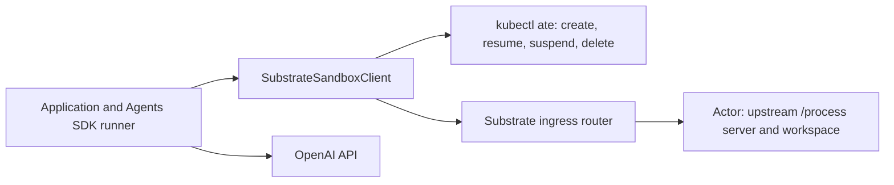

# openai-agent-substrate

A standalone Python proof of concept that runs **OpenAI Agents SDK `SandboxAgent` tools in an Agent Substrate Actor**. The SDK harness stays in your application; shell execution and workspace files live in the Actor.

The default demo is key-free. It drives the real SDK runner with a deterministic model and a loopback execution-protocol simulator. Real Substrate mode uses the upstream sandbox demo server and `kubectl ate`.

## Quick start

Requires Python 3.11+ and [uv](https://docs.astral.sh/uv/).

```sh
uv sync --locked
uv run openai-agent-substrate
uv run pytest -q
```

The demo creates a workspace, invokes the SDK's `exec_command` tool, writes a report, closes/suspends the session, serializes its state, resumes it, and runs a second tool call. It checks that both the report and an edited input file survived without the initial manifest overwriting them. The report and verification summary appear in `artifacts/`.

**Local mode runs fixed test commands on your host. It provides no sandbox isolation and does not emulate Kubernetes scheduling, memory snapshots, or durable storage.** The CLI allows only the scripted model in local mode.

## Run on Agent Substrate

Use a cluster with Substrate installed and the upstream sandbox demo's `sandbox-template` prepared. See [deploy/README.md](deploy/README.md) for prerequisites and router access.

```sh
uv run openai-agent-substrate \
  --backend substrate \
  --context YOUR_KUBERNETES_CONTEXT \
  --router-url http://127.0.0.1:8000 \
  --atespace ate-demo-sandbox \
  --template sandbox-template
```

This still uses the scripted model, so it verifies execution and suspend/resume against a real cluster without making OpenAI API calls. It creates a uniquely named Actor and deletes it on exit by default.

For a live model, set `OPENAI_API_KEY` in the **host** environment and add `--model YOUR_OPENAI_MODEL_ID`. The key is used by the SDK harness and is never put in the manifest or execution request. Hosted tracing is disabled in this demo.

To retain the workspace, add `--keep-actor`. Closing the session requests `kubectl ate suspend actor --mode sync`; after the second suspension, the demo saves `artifacts/session.json`. This retains the Actor and its storage until you explicitly delete it:

```sh
kubectl ate --context YOUR_KUBERNETES_CONTEXT delete actor ACTOR_NAME --atespace ate-demo-sandbox
```

Read the Actor name from the demo output. Do not delete the shared template or worker pool to clean up one run.

## Integrate into your application

```python
from agents import Runner
from agents.run import RunConfig
from agents.sandbox import Manifest, SandboxAgent, SandboxRunConfig
from agents.sandbox.capabilities import Filesystem, Shell
from agents.sandbox.entries import File
from openai_agent_substrate import (
    KubectlActorControl, SubstrateSandboxClient, SubstrateSandboxOptions,
)

client = SubstrateSandboxClient(
    router_url="http://127.0.0.1:8000",
    atespace="ate-demo-sandbox",
    control=KubectlActorControl(context="YOUR_KUBERNETES_CONTEXT"),
)
manifest = Manifest(entries={"task.txt": File(content=b"Write a short report.")})
agent = SandboxAgent(
    name="Substrate worker",
    instructions="Read task.txt and write report.txt in the workspace.",
    capabilities=[Shell(), Filesystem()],
    default_manifest=manifest,
)
session = await client.create(
    manifest=manifest,
    options=SubstrateSandboxOptions(template="sandbox-template"),
)
try:
    async with session:
        result = await Runner.run(
            agent, "Complete the task.",
            run_config=RunConfig(
                sandbox=SandboxRunConfig(session=session),
                tracing_disabled=True,
            ),
        )
finally:
    await client.delete(session)
```

The example belongs inside an async function. Set the host API key and a model available to your account when using a live model.

For retained sessions, omit deletion, serialize **after** closing, and reconnect using the same configured client:

```python
payload = client.serialize_session_state(session.state)
# Save payload as JSON in trusted application storage.
resumed = await client.resume(client.deserialize_session_state(payload))
async with resumed:
    # Pass resumed through SandboxRunConfig(session=resumed).
    ...
```

Keep SDK conversation history or `RunState` separately. Actor suspension preserves compute/workspace state, not the external SDK harness. `demo.py` shows carrying `result.to_input_list()` into the next run.

## Architecture and boundaries



The adapter sends `POST /process` with `command`, `cwd`, and a Go-duration `timeout`, plus `ate-target-actor: ATESPACE/ACTOR_NAME`. Control-plane credentials and the router endpoint are bound to the client, rather than restored from saved session state. Commands are never automatically retried, including on malformed responses, HTTP errors, or redirects: an ambiguous failure may have already executed a side effect.

The upstream demo has no application authorization and buffers command output in memory. Use it only behind a trusted private ingress. Substrate provides the sandbox boundary; this adapter does not add authentication or make the demo production-ready.

| Supported in this POC | Explicit limit |
| --- | --- |
| Real SDK `SandboxSession`, `Shell()`, and `Filesystem()` | SDK pinned to `openai-agents==0.24.0`; uses provider base-class APIs |
| `File`, `Dir`, `LocalFile`, and `LocalDir` manifests | No cloud mounts, GitRepo materialization, custom users/groups, manifest environment, or extra path grants |
| Binary file reads/writes over base64 | 1 MiB per file; 4 MiB execution response; writes are chunked |
| Existing Actor suspension/resumption | Substrate owns snapshots; no portable SDK tar export/import or replacement Actor recovery |
| Synchronous shell execution and nonzero exit codes | No PTY, stdin streaming, preview ports, or precise timeout-vs-signal classification |
| One application owns a session at a time | Do not concurrently resume, run, or delete the same Actor from multiple workers |

Cancelling the Python coroutine does not guarantee cancellation of an in-flight HTTP request; the remote command has its own deadline. The demo server's Go `CommandContext` does not provide process-group management for shell grandchildren. File operations validate SDK workspace paths, but the shell intentionally has Actor-level access; workspace path validation is not an OS isolation boundary.

## Verification

```sh
uv run pytest -q
uv run openai-agent-substrate --output-dir artifacts/local
```

Tests cover the actual SDK tool loop, filesystem patching, binary/chunked files, shell output/exit codes, routing headers, state serialization and resume, lost Actors, unsupported manifest options, file limits, and non-replay of failed executions.

For wire compatibility with the actual upstream Go execution server:

```sh
mkdir -p artifacts
go build -o artifacts/upstream-sandbox-server third_party/substrate-sandbox/main.go
SUBSTRATE_DEMO_BINARY="$PWD/artifacts/upstream-sandbox-server" uv run pytest -q
uv run openai-agent-substrate \
  --upstream-binary "$PWD/artifacts/upstream-sandbox-server" \
  --output-dir artifacts/upstream
```

This runs the actual upstream HTTP execution code locally. Lifecycle operations remain simulated; it does not prove Kubernetes suspend/resume. The upstream server briefly listens on the selected port on all host interfaces, matching its source. Run this compatibility check only on a trusted development machine.

## Sources and compatibility

- [Official OpenAI Sandbox Agents guide](https://developers.openai.com/api/docs/guides/agents/sandboxes)
- [OpenAI sandbox-as-a-tool cookbook](https://developers.openai.com/cookbook/examples/agents_sdk/sandboxed-code-migration/sandboxed_code_migration_agent)
- [Agent Substrate sandbox demo](https://github.com/agent-substrate/substrate/tree/6949841e9dc98edbd2e0042ef95c19b4ce20aef5/demos/sandbox)
- [Verified Actor lifecycle CLI](https://github.com/agent-substrate/substrate/blob/6949841e9dc98edbd2e0042ef95c19b4ce20aef5/cmd/kubectl-ate/internal/cmd/actor.go)

Upstream changes quickly. The provider was developed against the SDK above and Substrate commit `6949841e9dc98edbd2e0042ef95c19b4ce20aef5` (2026-10-29). The copied execution server retains its Apache-2.0 license in `third_party/substrate-sandbox/`. See `VERIFICATION.md` for the checks performed in this environment.
