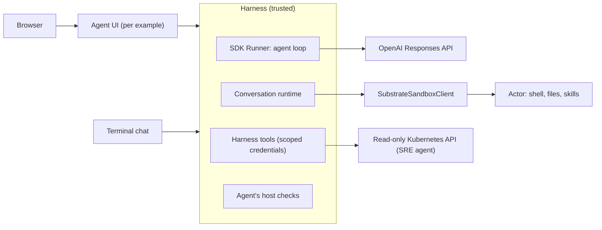

# Agent harness

This project follows the [harness separate from compute](architecture.md)
pattern: the agent loop runs in a trusted harness and tool execution runs in a
sandbox. Before this design the harness lived inside the Document Intelligence
UI, mixed with that agent's behavior and with Substrate details. A second agent would have
copied all of it. This design splits the code so that adding an agent means
writing the agent, not another harness.

## Three parts

| Part | Owns | Code |
| --- | --- | --- |
| **Agent example** | Instructions, skills, tools, the starting workspace, the sandbox image and size, host checks of its outputs, and its front ends: a terminal chat, a UI, or both | `examples/starter/`, `examples/document_intelligence/`, `examples/sre/` |
| **Harness** | The SDK agent loop and history; one sandbox session per conversation; locking, waiting for sandbox capacity, turn records, uploads, collecting outputs, recording tool evidence, running the agent's checks, tracing; the ChatKit protocol, the UI page every agent shares and its routes, and a terminal chat | `harness/` (the `openai-harness` package) |
| **Sandbox** | The SDK sandbox client for Agent Substrate, Actor lifecycle, and registering an agent's image and size as an ActorTemplate | `sandbox/` (the `openai-agent-substrate` package), `deploy/kubernetes/sandbox.py` |



Each agent example keeps its UI in its own `ui/` folder: its launcher, its
settings for the page (title, prompts, follow-ups, starting files) and, when it
shows its own file types, an `agent.js` renderer. The page itself is the
harness's (`openai_harness/static/`), so the three agents look and behave the
same, and a fix lands in all of them: the chat, a side panel that opens when a
turn writes files (files, the quotes the host checked, the turn's trace as a
harness/sandbox timeline), suggestions that fill the composer, the turn's result
under the chat, links to conversations, free sandbox slots, and a delete that
says what it removes. The [harness guide](../harness/README.md#the-ui) lists the
settings and behavior.

The harness also provides a terminal chat (`openai_harness.terminal`), which
drives the same server in-process, so a terminal conversation is an ordinary
thread that the agent's UI also lists and links to. The starter agent uses the
terminal chat as the quick start's last step and keeps its UI optional. Each
process locks a conversation only for itself, so a message for a conversation
another process is running a turn of is refused: the UI shows that it is
running elsewhere until the turn ends.

## Standards, not a new agent format

An agent is a plain OpenAI Agents SDK
[`SandboxAgent`](https://openai.github.io/openai-agents-python/sandbox/guide/):
instructions, capabilities (shell, filesystem, skills) and a default manifest.
Skills use the [Agent Skills](https://agentskills.io) `SKILL.md` folder format,
which the SDK's `Skills` capability loads. The model API is the Responses API,
which OpenAI has contributed to the Agentic AI Foundation as Open Responses.
Conversation history is an SDK
[session](https://openai.github.io/openai-agents-python/sessions/)
(`SQLiteSession` now; `SQLAlchemySession` works with Postgres), while ChatKit's
own store keeps threads and items, as the SDK documentation recommends for a
ChatKit server. The UI protocol is ChatKit. Harness tools are SDK function
tools; MCP servers are the natural next step for them.

The harness adds one small description beside the agent, `AgentSpec`, for what
the SDK does not cover:

| Field | Purpose |
| --- | --- |
| `name` | Label for traces and logs |
| `build_agent(manifest, model)` | Returns the `SandboxAgent` |
| `start(conversation, has_uploads, root)` | The first turn's workspace manifest, rooted at the sandbox's workspace |
| `instructions(conversation)` | Text added to every turn, such as how follow-up turns work |
| `tools(turn)` | Harness tools for this turn; they run in the harness, never in the sandbox |
| `uploads` | Accepted file types, size limits and per-type processors (PDF pages) |
| `check(conversation, turn, files)` | The host check of this turn's outputs |
| `collect` | Workspace folders copied to the host after each turn (default `output`, `work`) |
| `default_question` | The question used when a message has only attachments |

## What the harness does on every turn

1. **Lock, then reload.** Turns in one conversation never overlap: they share a
   workspace. ChatKit loads the thread before the harness takes the
   conversation's lock, so the harness reloads the thread after taking it.
   Without that, a second message sent during a running turn overwrote the
   first turn's record and history.
2. **Create or resume the sandbox, waiting for capacity.** The provider raises
   `ActorCapacityError` when Substrate has no worker with room. The harness shows
   a waiting step, retries with backoff for up to five minutes, then fails with
   a message that says the workers are busy. Every failure is logged on the
   server; the browser sees only safe text.
3. **Check the boundary** on a new workspace: no API key or Secret mount in the
   sandbox.
4. **Stage uploads** from the host's retained copies, then run the agent's
   processors (PDF text and page images are produced inside the sandbox).
5. **Run the agent loop** with the conversation's SDK session and this turn's
   harness tools. Tool calls stream to ChatKit as workflow steps. If the turn
   fails, the items it added to the session are removed, so a retry starts clean.
6. **Record evidence.** A harness tool's output is saved on the host and written
   into the workspace under `evidence/`, so code in the sandbox can analyze it.
   Checks compare against the host copy, which the sandbox cannot edit.
7. **Collect and check.** Files in the agent's `collect` folders are copied to
   the host; the agent's check runs on them and on the host copies.
8. **Suspend** the sandbox and save its session state with the thread.

## The SRE agent

The SRE agent investigates unhealthy workloads in Kubernetes namespaces it is
allowed to read. It shows why some tools belong in the harness:

- **Reads run in the harness** with a dedicated ServiceAccount
  (`sre-agent-reader`) bound by a Role in each allowed namespace. It can read
  pods, logs, events and workload objects. It cannot read Secrets or ConfigMaps,
  and it cannot change anything. The harness mints a short-lived token for it
  and also refuses namespaces outside its allowlist.
- **Analysis runs in the sandbox.** Every read is saved under `evidence/`. The
  agent loads its `kubernetes-triage` skill and uses the shell and Python on
  those files. The sandbox holds no credentials.
- **Findings are checked.** `output/findings.json` lists each finding with
  quotes from evidence files; the host checks every quote against its own copy.
- **No actions.** Fixes are proposals. Write actions would need SDK tool
  approvals and are out of scope.

On Kind, `sre-setup` deploys the sandbox template, the reader ServiceAccount
and a demo namespace with a crash-looping and an unpullable workload.

## Layout

```text
pyproject.toml                uv workspace root
sandbox/                      Provider package: src/agent_substrate (ActorCapacityError added), tests/
harness/                      Harness package openai-harness: src/openai_harness/
  spec.py                     AgentSpec, Conversation, TurnContext
  chat.py                     ChatKit adapter and conversation runtime
  uploads.py, steps.py        Upload staging; tool calls as workflow steps
  store.py, traces.py         ChatKit's SQLite store; Jaeger trace summary
  http.py                     The shared UI page's routes (ui_application)
  static/                     The shared UI page: chat, side panel, trace timeline
  capacity.py                 Free sandbox slots for the header
  terminal.py                 Terminal chat on the same server and store as the UIs
  settings.py                 OPENAI_* settings for launchers
  testing.py                  Scripted model and ChatKit helpers for agents' tests
harness/tests/                Lock and reload, capacity waits, history, evidence, the UI's routes
deploy/kubernetes/sandbox.py  Sandbox profile to ActorTemplate (deploy time)
examples/starter/             The golden path: smallest complete agent, terminal chat and optional UI (port 8002)
examples/document_intelligence/
  agent/                      SandboxAgent, skills, spec, PDF processor, citation checks
  ui/                         Its page settings, PDF view, card and launcher (port 8000)
examples/sre/
  agent/                      SandboxAgent, triage skill, cluster tools, spec, evidence check
  deploy/                     Sandbox image, reader RBAC, demo workloads
  ui/                         Its page settings, card and launcher (port 8001)
```

The repository is a uv workspace. The provider (`sandbox/`) and the harness
(`harness/`) are separate packages, so their boundary is a dependency: the
provider cannot import the harness or ChatKit. Only the provider is meant for
publishing today: the harness listens on loopback only, has no sign-in and keeps
conversations in SQLite. Once it runs in the cluster with sign-in and Postgres,
it can be published on its own. The agents stay in `examples/`: a top-level
`agents/` package would shadow the Agents SDK, whose import name is `agents`.

## Next steps

In rough order, as the harness grows:

1. **Split the runtime from ChatKit.** `chat.py` holds both the conversation
   runtime and the ChatKit protocol. A runtime that reports progress as plain
   events would let the chat UIs, the terminal chat (which now reads the ChatKit
   stream), a Kubernetes Job and alert webhooks share it. The Document
   Intelligence command line and Job would then drop their own runner.
2. **One launcher.** The two UI launchers repeat argument parsing, client,
   store and tracing setup; a shared `serve` helper would cut each to a few lines.
3. **Run the harness in the cluster.** Postgres for the ChatKit store and
   `SQLAlchemySession` for history, object storage for the host copies of
   uploads and evidence, and sign-in before anyone else can reach it.
4. **More harness tools.** MCP servers, SDK tool approvals for write actions,
   and alert-triggered runs for the SRE agent.
5. **Smaller items.** Recognize a full worker pool from Substrate's structured
   error rather than its message text, and report free slots from a Substrate
   API rather than `kubectl ate get worker`'s table.

Conversations from before the harness are not migrated: the UIs use new data
folders.
