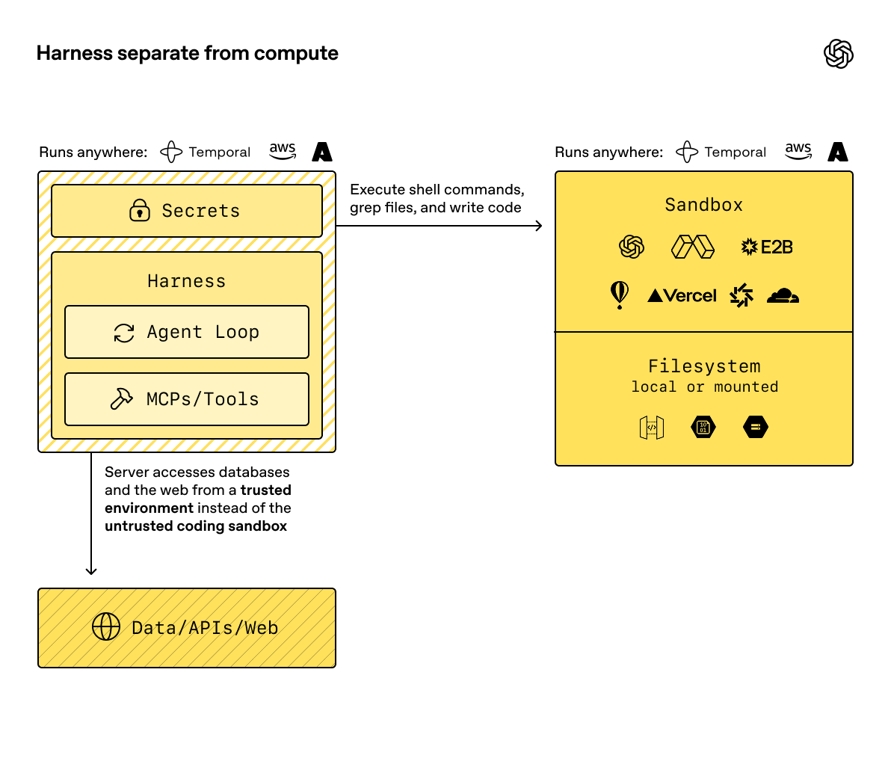
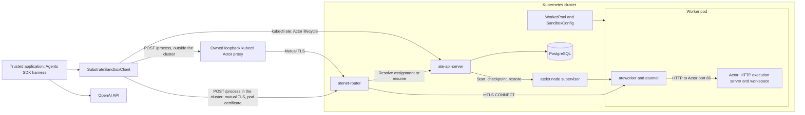

# Architecture

The trusted application runs the Agents SDK loop and calls the model.
`SubstrateSandboxClient` connects the SDK sandbox interface to Agent Substrate
v1.0.0 for commands, workspace files, and Actor lifecycle. The example harness
keeps one Actor per conversation. [SDK integration](usage.md#integrate-into-your-application) · [Shared harness](../harness/README.md) · [OpenAI Sandbox Agents guide](https://developers.openai.com/api/docs/guides/agents/sandboxes)

*Diagram from the [official OpenAI documentation](https://developers.openai.com/api/docs/guides/agents/sandboxes).*

## Kubernetes and Substrate

Kubernetes manages `WorkerPool` and `SandboxConfig` custom resources. The
Substrate controller reconciles a `WorkerPool` into Deployments of worker pods.
The pool selects sandbox classes and resolves their runtime assets from
`SandboxConfig`. The reference Kind deployment uses gVisor. Substrate also
supports microVM workers on suitable clusters. [Upstream resource model and sandbox classes](https://ate.dev/docs/concepts/architecture/#api-resource-models)

Substrate's gRPC API manages `ActorTemplate`, `Actor`, `Worker` and
`ActorAssignment` records in PostgreSQL. An `ActorTemplate` defines the
workload and selects eligible workers by label. A worker pod can host several
Actors, and the scheduler can place a resumed Actor on a different worker.
`atelet`, the node supervisor, asks `ateworker` to start, checkpoint and restore
the workload. Snapshot files move through object-store plugins that serve the
node supervisor and control plane. [Upstream system components](https://ate.dev/docs/concepts/architecture/#system-components)

The adapter sends `POST /process` with `command`, `cwd` and a Go-duration
`timeout`. The `Host` header retains its HTTP authority. `atenet-router` uses
`ate-target-actor: ATESPACE/ACTOR_NAME` to resolve the assignment and can resume a
suspended Actor on demand. The router then
opens an authenticated tunnel to `atunnel` in the assigned worker, which forwards
the request to the Actor's HTTP server on port 80. The adapter explicitly resumes
the session before staging files or running tools, so the harness can report
worker-capacity waits at the start of the turn. [Upstream networking and lifecycle](https://ate.dev/docs/concepts/architecture/#networking-stack-atenet--atunnel)

By default each session owns a `kubectl ate proxy actor` process. The proxy
obtains a Pod Identity certificate and authenticates to the router. It opens an
ephemeral loopback port and closes it with the session. Processes that can reach
the loopback port can execute commands in the Actor. In a Kubernetes-hosted
harness, `router_url` names the router and `router_tls` presents the pod's own
certificate. An explicit `router_url` can also name a trusted gateway. The
application supplies the routing endpoint and credentials when it constructs the
client. The adapter sends each command once because an ambiguous failure can
already have caused a side effect.

The upstream demo buffers command output in memory. Access control belongs at
the trusted private ingress because the demo accepts commands from callers that
reach it.

`atunnel` sends outbound TCP through `atenet-egress` for policy enforcement.
The reference deployment keeps the default-deny rules for Actor egress and
credential injection, and the trusted harness makes model calls using its own
credentials. [Upstream egress policy](https://ate.dev/docs/guides/egress-traffic/) · [Credential injection](https://ate.dev/docs/guides/egress-credential-injection/)

| Supported by this reference implementation | Explicit limit |
| --- | --- |
| Real SDK `SandboxSession`, `Shell()`, and `Filesystem()` | SDK pinned to `openai-agents==0.24.0`; uses provider base-class APIs |
| Native SDK `Skills` with eager or lazy local skill files | Skills materialize as workspace files; Git-backed sources and external mounts remain unsupported |
| `File`, `Dir`, `LocalFile`, and `LocalDir` manifests | No cloud mounts, GitRepo materialization, custom users/groups, manifest environment, or extra path grants |
| Binary file reads/writes over base64 | 10 MiB per file by default (`max_file_bytes`); writes send up to 630 KiB per command, reads return up to 1 MiB per command; 4 MiB execution response |
| Command stdout/stderr as UTF-8 JSON text | Invalid UTF-8 bytes are replaced by U+FFFD upstream; use base64-backed file reads/writes for binary data |
| Existing Actor suspension/resumption | Substrate owns snapshots; no portable SDK tar export/import or replacement Actor recovery |
| Synchronous shell execution and nonzero exit codes | No PTY, stdin streaming, preview ports, or precise timeout-vs-signal classification |
| One application owns a session at a time | Do not concurrently resume, run, or delete the same Actor from multiple workers |

File transfer uses shell commands over `/process`. Each round trip took about
0.4 seconds in the local Kind benchmark, so reducing the number of calls helps.
A write sends as much data per command as the argument limits allow: 90 KiB base64
parts, which stay under Linux's 128 KiB per-argument limit, seven to a command,
which stays under macOS's 1 MiB argument limit for the local simulator. The
first command creates a hidden partial file next to the target and the last
renames it into place, so the target appears complete or not at all; a failure
removes the partial file. A small file takes one command. A read returns the
file size and up to 1 MiB of base64 per command, so a file larger than the
limit is refused before its contents are transferred. A file that changes
size between read commands raises an error.

Cancelling execution closes the provider's HTTP connection. The upstream
server uses the request context and command deadline to stop the command.
Effects that occurred before disconnect can remain in the workspace, and Go's
`CommandContext` can leave shell grandchildren alive. A Substrate router resume
already accepted before disconnect can also complete independently. Workspace
path validation applies to the file API. The shell has Actor-level access.

## Kubernetes-hosted harness

The terminal chats and UIs run on the operator's host. The Document Intelligence
Job runs the trusted harness in a Kubernetes pod. The Job receives configuration
from `envFrom.secretRef` and a read-only Secret volume, and keeps the SDK model
connection, Kubernetes ServiceAccount and Substrate CLI in the pod. A preflight
checks the Actor for the harness API key and Secret mount before processing.
[Document Intelligence Job](../examples/document_intelligence/deploy/README.md)

The harness pod authenticates as its own ServiceAccount, `openai-agent`.

- Actor lifecycle goes to the API service at `api.ate-system.svc:443` with a
  projected token for that account. A Substrate access policy grants it `editor`
  on its atespace.
- Commands go to the router at `atenet-router.ate-system.svc` over mutual TLS
  with the pod's own certificate, which the router admits because the install
  lists the account's SPIFFE ID.
- Its only Kubernetes permission is reading ClusterTrustBundles, which
  `kubectl ate` uses to verify the API.

The host UIs use the CLI proxy under the operator's kubeconfig. The router's
ingress allowlist admits clients across Actors. `ate-api-server` separately
applies per-atespace OpenFGA policy to lifecycle calls. [Substrate authorization](https://ate.dev/docs/guides/authorization/) · [In-cluster deployment](deployment.md#a-harness-in-the-cluster)

Shared applications can use the Actor execution gateway to authorize caller
identities against exact Actor references. Place the gateway between those
callers and the router so their command traffic goes through that policy. API
lifecycle authorization still belongs to Substrate and the owning application.
[Actor gateway](../deploy/kubernetes/actor_gateway/README.md)

## Workspace persistence and conversations

The provider creates an Actor in the suspended state. On first start,
Substrate restores the template's golden snapshot when available or boots from
the template image. Later starts restore the Actor's own checkpoint. Each example template requests
`MEMORY` snapshots and mounts a per-Actor `durableDir` at `/workspace`, with the
SDK workspace root pointing there. The workspace files are included with the
Actor's snapshots and the volume follows the Actor across workers. Deleting the
Actor removes its workspace. [Upstream Actor lifecycle](https://ate.dev/docs/concepts/architecture/#actor-lifecycle)

On close the adapter requests `SuspendActor` in synchronous mode (`--mode sync`).
Substrate checkpoints the Actor, waits for durable object storage upload and
reclaims the worker capacity. The next turn can restore from a node-local copy
when one is available or from durable storage. Asynchronous suspend is an
upstream option that returns after the local checkpoint and uploads later.
[Upstream snapshot persistence](https://ate.dev/docs/concepts/architecture/#state-management--persistence)

The shared harness stores serialized Actor session state with each ChatKit
thread. Different conversations run concurrently in separate Actors with their
own workspace volumes. A host file lock serializes turns and deletion for
each conversation, and the harness records Actor creation intent before making
the lifecycle call. User uploads enter the volume through the provider's file API,
which defaults to 10 MiB per file. [Shared agent harness](../harness/README.md#a-turn)

## Conversation lifecycle and density

The example harness owns the Actor's active session for the turn, including workspace
setup, tool execution and output collection. Closing the session suspends the
Actor and releases its worker capacity between turns.

When Substrate signals worker eviction, the example server reports it on the
same routed Actor connection. The external harness stops the turn, records the
pending notice, and requests synchronous suspend. The notice stays visible in
the Actor. After a successful checkpoint, the harness records which notice it
handled so that a restored process can report a later signal independently.
Recovery depends on the worker remaining reachable until Substrate completes
the checkpoint. Applications that own their sessions can wrap active work in
`eviction_watch` and store the session state for recovery.
[Session ownership and retention](usage.md#choose-how-to-retain-a-session) · [Kind eviction check](local-kubernetes.md#test-worker-eviction) · [Upstream eviction guidance](https://ate.dev/docs/reference/api-guide/#eviction)

| Moment | What happens |
| --- | --- |
| First message | The harness creates the Actor (created suspended) and starts it on a worker with room; the workspace volume is created with it |
| During the turn | The agent loop and credentialed tools run in the harness. Sandbox tools run in the Actor |
| End of the turn | The harness copies outputs to the host, runs the agent's check, and suspends the Actor (`--mode sync`), which frees its worker |
| Next message | The harness resumes the same Actor, possibly on another worker, and reopens the workspace |
| Conversation deleted | The harness deletes the Actor and its volume |

Each active turn needs space on a worker. Capacity depends on the ActorTemplate
and the worker pool. When the pool is full, the harness shows a waiting step and
retries startup up to its configured deadline. [Kind cluster sizing](local-kubernetes.md#cluster-size)

Raw documents, rendered pages and intermediate files stay in the sandbox's
workspace. What reaches the model, and therefore the conversation history, is
what the agent reads: command output it prints, files it opens, and page images
it views with `view_image`.

## Domain skills and code execution

The [Document Intelligence example](../examples/document_intelligence/README.md)
keeps orchestration and original-input checks in the harness. The native SDK
`Skills` capability discovers a local `agent/skills/document-analysis` bundle and materializes
it in the Actor on `load_skill`. Shell tools read its instructions and run its
extractor. The agent writes `work/analyze.py` with `apply_patch`, executes Python
inside the Actor, and produces reports for independent host verification. Its
Python-capable image is built separately from the harness; model credentials stay
with the harness. Scripted mode exercises the same SDK tools without inference.

## Sources and compatibility

- [Official OpenAI Sandbox Agents guide](https://developers.openai.com/api/docs/guides/agents/sandboxes)
- [OpenAI sandbox-as-a-tool cookbook](https://developers.openai.com/cookbook/examples/agents_sdk/sandboxed-code-migration/sandboxed_code_migration_agent)
- [Agent Substrate architecture](https://ate.dev/docs/concepts/architecture/)
- [Agent Substrate v1.0.0 release](https://github.com/agent-substrate/substrate/releases/tag/v1.0.0)
- [Agent Substrate v1.0.0 sandbox demo](https://github.com/agent-substrate/substrate/tree/v1.0.0/demos/sandbox)
- [Agent Substrate CLI reference](https://ate.dev/docs/reference/kubectl-ate/)

`.substrate-revision` pins the v1.0.0 release commit
`b34fbee742906494b5eb4f1f36987176bf8770a4`. `scripts/build-sandbox-server.sh`
builds the upstream execution server from the pinned Go module alongside the
project's eviction notice handler. Each sandbox image carries upstream's
Apache-2.0 license. [Verification record](verification.md)
