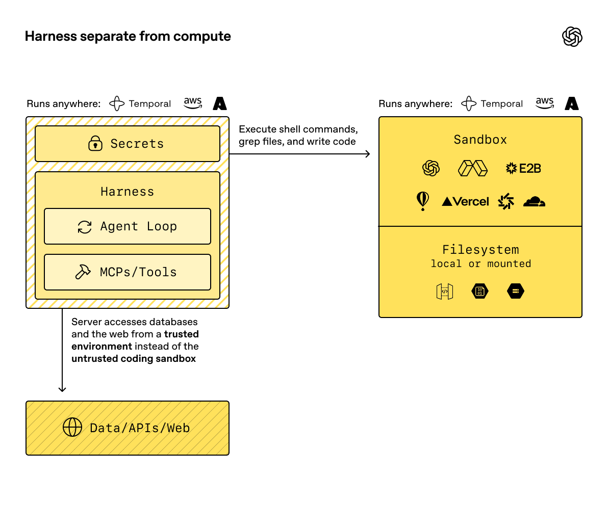
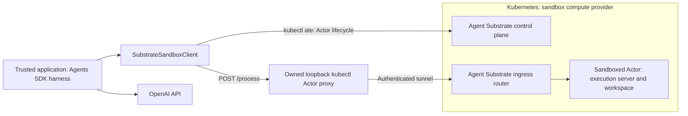

# Architecture

This project follows the **harness separate from compute** pattern in the [OpenAI Sandbox Agents guide](https://developers.openai.com/api/docs/guides/agents/sandboxes). The Agents SDK harness runs in the trusted application. Kubernetes provides sandbox compute through Agent Substrate, which manages the Actors that execute shell commands and own the workspace. `SubstrateSandboxClient` adapts this Kubernetes-backed execution environment to the SDK sandbox interface.

*Diagram from the [official OpenAI documentation](https://developers.openai.com/api/docs/guides/agents/sandboxes).*

The following diagram shows Kubernetes as the sandbox compute provider and Agent Substrate as its sandbox runtime and lifecycle layer:

The adapter sends `POST /process` with `command`, `cwd`, and a Go-duration `timeout`, plus `ate-target-actor: ATESPACE/ACTOR_NAME`. By default it owns a `kubectl ate proxy actor` process per session; the proxy obtains the required Pod Identity certificate and authenticates to Substrate ingress. It listens only on an ephemeral loopback port and is closed when the session closes. This local port has no application authentication: any process able to connect to it can execute commands in that Actor. Loopback binding limits network exposure, but does not isolate users or processes sharing a host or pod network namespace. An explicit `router_url` selects a trusted external gateway instead. Control-plane credentials and the router endpoint are bound to the client, rather than restored from saved session state. Commands are never automatically retried, including on malformed responses, HTTP errors, or redirects: an ambiguous failure may have already executed a side effect.

The upstream demo has no application authorization and buffers command output in memory. Use it only behind a trusted private ingress. Substrate provides the sandbox boundary; this adapter does not add authentication or make the demo production-ready.

| Supported by this reference implementation | Explicit limit |
| --- | --- |
| Real SDK `SandboxSession`, `Shell()`, and `Filesystem()` | SDK pinned to `openai-agents==0.24.0`; uses provider base-class APIs |
| Native SDK `Skills` with eager or lazy local skill files | Skills materialize as workspace files; Git-backed sources and external mounts remain unsupported |
| `File`, `Dir`, `LocalFile`, and `LocalDir` manifests | No cloud mounts, GitRepo materialization, custom users/groups, manifest environment, or extra path grants |
| Binary file reads/writes over base64 | 10 MiB per file by default (`max_file_bytes`); writes send up to 630 KiB per command, reads return up to 1 MiB per command; 4 MiB execution response |
| Command stdout/stderr as UTF-8 JSON text | Invalid UTF-8 bytes are replaced by U+FFFD upstream; use base64-backed file reads/writes for binary data |
| Existing Actor suspension/resumption | Substrate owns snapshots; no portable SDK tar export/import or replacement Actor recovery |
| Synchronous shell execution and nonzero exit codes | No PTY, stdin streaming, preview ports, or precise timeout-vs-signal classification |
| One application owns a session at a time | Do not concurrently resume, run, or delete the same Actor from multiple workers |

File transfer runs over the same `/process` endpoint, so its cost is the number
of commands: on local Kind each round trip takes about 0.4 s whatever its size,
and concurrent commands to one Actor run one after another. A write therefore
sends as much data per command as the argument limits allow: 90 KiB base64
parts, which stay under Linux's 128 KiB per-argument limit, seven to a command,
which stays under macOS's 1 MiB argument limit for the local simulator. The
first command creates a hidden partial file next to the target and the last
renames it into place, so the target appears complete or not at all; a failure
removes the partial file. A small file takes one command. A read returns the
file size and up to 1 MiB of base64 per command, so a file larger than the
limit is refused before its contents are transferred. A file that changes
size between read commands raises an error.

Cancelling the Python coroutine does not guarantee cancellation of an in-flight HTTP request; the remote command has its own deadline. The demo server's Go `CommandContext` does not provide process-group management for shell grandchildren. File operations validate SDK workspace paths, but the shell intentionally has Actor-level access; workspace path validation is not an OS isolation boundary.

## Kubernetes-hosted harness

The trusted application may itself run in a Kubernetes pod. The
[agent Job](../examples/document_intelligence/deploy/README.md) receives `.env` configuration through
`envFrom.secretRef` and a read-only Secret volume. The SDK model connection,
Kubernetes ServiceAccount, and Substrate CLI remain in that harness pod. The
untrusted execution Actor is a separate workload with its own image and workspace.
A preflight check confirms the Actor has neither the harness API key nor its
Secret mount before document processing begins.

The harness calls the in-cluster API service directly at `api.ate-system.svc:443`.
The pinned upstream Actor proxy still uses a Kubernetes port-forward for its
router CONNECT tunnel, even when a direct API endpoint is configured. Its Role
therefore allows forwarding only to the router pod names discovered during
setup. Namespace-wide pod listing remains necessary for the upstream router
selector; direct pod reads and forwarding are restricted to the named routers.
The local run helpers refresh this allowlist before each Job. Direct helper users
should run `python -m deploy.kubernetes.base resources` after router rollouts.

## Workspace persistence and conversations

The provider maps the SDK workspace root to a directory in the Actor and leaves
persistence to Substrate: closing a session suspends the Actor, and resuming it
restores what the template's snapshots hold. A template can make the workspace
independent of process memory by mounting a per-Actor `durableDir` volume at the
workspace root. The Document Intelligence template does this at `/workspace`:
the volume is created with the Actor, kept by every snapshot across suspend and
resume, and deleted with the Actor. Kubernetes ephemeral volumes are not an
option here: an ActorTemplate mounts only `durableDir`, external CSI (a preview
feature) or `systemInfo` volumes, and a worker pod's emptyDir would not follow
an Actor that resumes on another worker.

A multi-turn application keeps one Actor per conversation. It creates the Actor
on the first message, stores the serialized session state with the
conversation, resumes the Actor for each later message, and deletes it with the
conversation. Different conversations run concurrently in separate Actors and
cannot see each other's files; turns within one conversation must not overlap
(see the table above). Files added later, such as user uploads, go through the
provider's file API (10 MiB per file by default) into the same volume. The
[Document Intelligence UI](../examples/document_intelligence/ui/README.md)
implements this pattern with ChatKit threads.

## Domain skills and code execution

The [Document Intelligence example](../examples/document_intelligence/README.md)
keeps orchestration and original-input checks in the harness. The native SDK
`Skills` capability discovers a local `agent/skills/document-analysis` bundle and materializes
it in the Actor on `load_skill`. Shell tools read its instructions and run its
extractor. The agent writes `work/analyze.py` with `apply_patch`, executes Python
inside the Actor, and produces reports for independent host verification. Its
Python-capable image is built separately from the harness; model credentials stay
with the harness. Scripted mode exercises the same SDK tools without inference.

## Sources and compatibility

- [Official OpenAI Sandbox Agents guide](https://developers.openai.com/api/docs/guides/agents/sandboxes)
- [OpenAI sandbox-as-a-tool cookbook](https://developers.openai.com/cookbook/examples/agents_sdk/sandboxed-code-migration/sandboxed_code_migration_agent)
- [Agent Substrate sandbox demo](https://github.com/agent-substrate/substrate/tree/6949841e9dc98edbd2e0042ef95c19b4ce20aef5/demos/sandbox)
- [Verified Actor lifecycle CLI](https://github.com/agent-substrate/substrate/blob/6949841e9dc98edbd2e0042ef95c19b4ce20aef5/cmd/kubectl-ate/internal/cmd/actor.go)

Upstream changes quickly. The provider was developed against the SDK above and Substrate commit `6949841e9dc98edbd2e0042ef95c19b4ce20aef5` (2026-10-29). The copied execution server retains its Apache-2.0 license in `third_party/substrate-sandbox/`. See [verification record](verification.md) for the checks performed in this environment.

The dedicated harness namespace carries `ate.dev/api-access=true`, as required by
Substrate's existing API ingress policy. Secret refresh preserves this label;
no control-plane NetworkPolicy is relaxed to enable the direct API connection.
