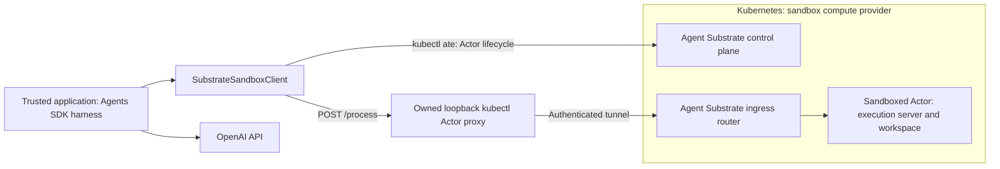

# Architecture

This project follows the **harness separate from compute** pattern in the [OpenAI Sandbox Agents guide](https://developers.openai.com/api/docs/guides/agents/sandboxes). The Agents SDK harness runs in the trusted application. Kubernetes provides sandbox compute through Agent Substrate, which manages the Actors that execute shell commands and own the workspace. `SubstrateSandboxClient` adapts this Kubernetes-backed execution environment to the SDK sandbox interface.

*Diagram from the [official OpenAI documentation](https://developers.openai.com/api/docs/guides/agents/sandboxes).*

The following diagram shows Kubernetes as the sandbox compute provider and Agent Substrate as its sandbox runtime and lifecycle layer:

The adapter sends `POST /process` with `command`, `cwd`, and a Go-duration `timeout`, plus `ate-target-actor: ATESPACE/ACTOR_NAME`. By default it owns a `kubectl ate proxy actor` process per session; the proxy obtains the required Pod Identity certificate and authenticates to Substrate ingress. It listens only on an ephemeral loopback port and is closed when the session closes. An explicit `router_url` selects a trusted external gateway instead. Control-plane credentials and the router endpoint are bound to the client, rather than restored from saved session state. Commands are never automatically retried, including on malformed responses, HTTP errors, or redirects: an ambiguous failure may have already executed a side effect.

The upstream demo has no application authorization and buffers command output in memory. Use it only behind a trusted private ingress. Substrate provides the sandbox boundary; this adapter does not add authentication or make the demo production-ready.

| Supported by this reference implementation | Explicit limit |
| --- | --- |
| Real SDK `SandboxSession`, `Shell()`, and `Filesystem()` | SDK pinned to `openai-agents==0.24.0`; uses provider base-class APIs |
| Native SDK `Skills` with eager or lazy local skill files | Skills materialize as workspace files; Git-backed sources and external mounts remain unsupported |
| `File`, `Dir`, `LocalFile`, and `LocalDir` manifests | No cloud mounts, GitRepo materialization, custom users/groups, manifest environment, or extra path grants |
| Binary file reads/writes over base64 | 1 MiB per file; 4 MiB execution response; writes are chunked |
| Existing Actor suspension/resumption | Substrate owns snapshots; no portable SDK tar export/import or replacement Actor recovery |
| Synchronous shell execution and nonzero exit codes | No PTY, stdin streaming, preview ports, or precise timeout-vs-signal classification |
| One application owns a session at a time | Do not concurrently resume, run, or delete the same Actor from multiple workers |

Cancelling the Python coroutine does not guarantee cancellation of an in-flight HTTP request; the remote command has its own deadline. The demo server's Go `CommandContext` does not provide process-group management for shell grandchildren. File operations validate SDK workspace paths, but the shell intentionally has Actor-level access; workspace path validation is not an OS isolation boundary.

## Kubernetes-hosted harness

The trusted application may itself run in a Kubernetes pod. The
[agent Job](../deploy/kubernetes/README.md) receives `.env` configuration through
`envFrom.secretRef` and a read-only Secret volume. The SDK model connection,
Kubernetes ServiceAccount, and Substrate CLI remain in that harness pod. The
untrusted execution Actor is a separate workload with its own image and workspace.
A preflight check confirms the Actor has neither the harness API key nor its
Secret mount before document processing begins.

## Domain skills and code execution

The [Document Intelligence example](../examples/document_intelligence/README.md)
keeps orchestration and original-input checks in the harness. The native SDK
`Skills` capability discovers a local `agent/skills/document-analysis` bundle and materializes
it in the Actor on `load_skill`. Shell tools read its instructions and run its
extractor. The agent writes `work/analyze.py` with `apply_patch`, executes Python
inside the Actor, and produces reports for independent host verification. Its
Python-capable image is built separately from the harness; model credentials stay
with the harness. Scripted mode exercises the same SDK tools without inference.

## Sources and compatibility

- [Official OpenAI Sandbox Agents guide](https://developers.openai.com/api/docs/guides/agents/sandboxes)
- [OpenAI sandbox-as-a-tool cookbook](https://developers.openai.com/cookbook/examples/agents_sdk/sandboxed-code-migration/sandboxed_code_migration_agent)
- [Agent Substrate sandbox demo](https://github.com/agent-substrate/substrate/tree/6949841e9dc98edbd2e0042ef95c19b4ce20aef5/demos/sandbox)
- [Verified Actor lifecycle CLI](https://github.com/agent-substrate/substrate/blob/6949841e9dc98edbd2e0042ef95c19b4ce20aef5/cmd/kubectl-ate/internal/cmd/actor.go)

Upstream changes quickly. The provider was developed against the SDK above and Substrate commit `6949841e9dc98edbd2e0042ef95c19b4ce20aef5` (2026-10-29). The copied execution server retains its Apache-2.0 license in `third_party/substrate-sandbox/`. See [verification record](verification.md) for the checks performed in this environment.
