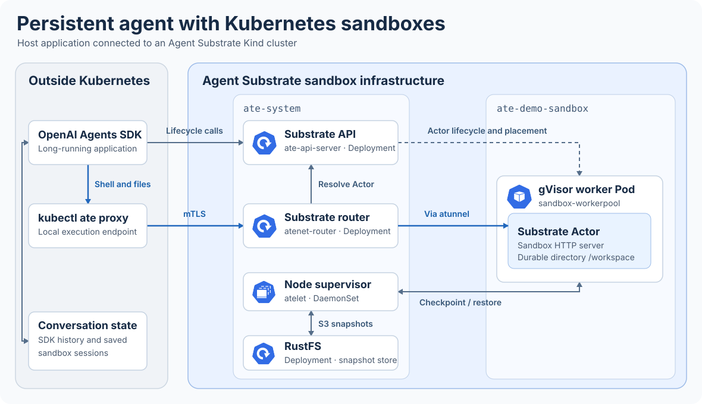
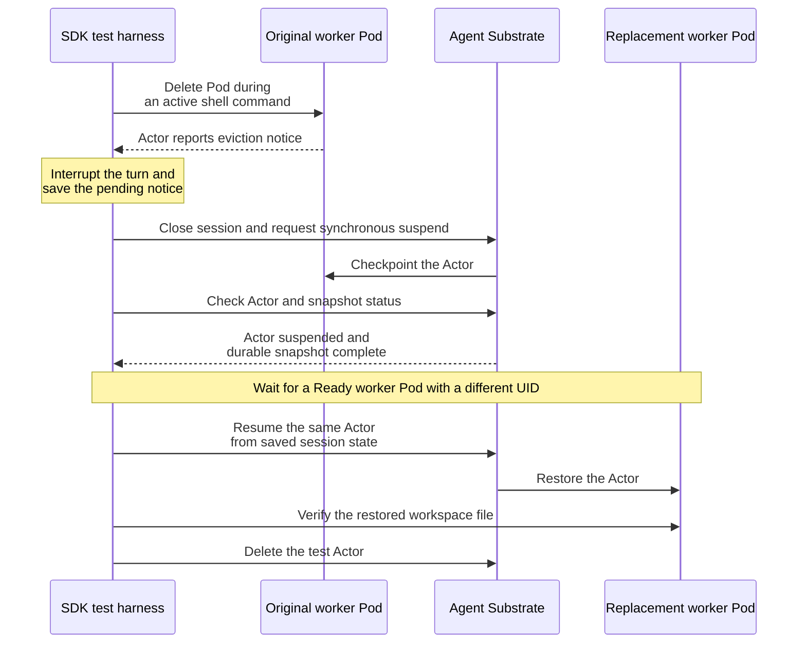

# Local Kubernetes setup and verification

Run a scripted SDK agent in a real gVisor-backed Actor on a dedicated Kind
cluster and verify that its workspace survives suspend and resume. These steps
need no `.env` file, OpenAI API key, or model calls.

## Requirements

- macOS with Colima, or a Linux host with Docker already running.
- Docker CLI, Git, Go, kubectl, and uv.
- Internet access for the pinned source, Go toolchain/modules, and container images.

On macOS, setup creates a Colima profile named `openai-agent-substrate` with 4 CPUs, 8 GiB RAM, and a 60 GiB virtual disk. The default Docker context and existing Kubernetes configuration remain unchanged. Linux uses the selected Docker daemon; use a dedicated daemon if another cluster already owns the `kind-registry` container on a different port.

## Set up

Initialize the cluster from the repository root.

```sh
./scripts/local-kubernetes.sh setup
```

Setup installs the pinned Agent Substrate release and sandbox demo in Kind. It
builds the `kubectl ate` plugin and writes a project-local kubeconfig under
`artifacts/local/`.

## Test

```sh
./scripts/local-kubernetes.sh test
```

The scripted provider check creates an Actor, runs a command that changes its
workspace, closes the session to suspend the Actor, then opens it from
serialized session state. The output and
`artifacts/local/results/verification.json` include these fields.

```json
{
  "backend": "Agent Substrate",
  "model": "scripted",
  "workspace_survived_resume": true,
  "initial_manifest_was_not_reapplied": true
}
```

The saved workspace report is `artifacts/local/results/report.txt`. The command
then runs the live Kubernetes test for binary file reads and writes, SDK patching,
nonzero exit codes, and session resume. Expect `1 passed`. Each check creates and
deletes its own Actor. Run `./scripts/local-kubernetes.sh status` to inspect
the node, system pods, and worker pool.

## Stop, restart and tear down

```sh
./scripts/local-kubernetes.sh stop
```

On macOS this stops the dedicated Colima profile and preserves its disk. Rerun
setup to restart it at the configured size. To keep the previous size, use
`colima start --profile openai-agent-substrate --activate=false --ssh-config=false`.
On Linux, manage the selected Docker daemon separately. The project-specific
kubeconfig selects the cluster explicitly.

```sh
./scripts/local-kubernetes.sh teardown
```

This runs the quickstart's `hack/delete-kind-cluster.sh`. It deletes the Kind
cluster and registry, including all Actors, snapshots, and templates, and
removes the project kubeconfig. Start new conversations after a later setup.
The old conversations under `artifacts/examples/` refer to deleted Actors and
can be removed.

## How setup works

The script follows Agent Substrate's own
[quickstart](https://ate.dev/docs/get-started/quickstart/) using the
[v1.0.0 release](https://github.com/agent-substrate/substrate/releases/tag/v1.0.0).
It checks out the commit in `.substrate-revision` under
`artifacts/local/substrate-<revision>/` and builds the tools from that source.
The deployment uses PostgreSQL, RustFS snapshot storage, and authenticated ingress.



The diagram shows the host placement used by the quickstart. The application
keeps conversation history and saved sandbox session state. Agent Substrate
runs shell and file requests in an Actor and uses RustFS snapshots to preserve
the Actor's `/workspace` across suspend and resume. An SDK application can also
run as a separate Kubernetes Deployment and connect to the same Substrate
services. [In-cluster configuration](deployment.md#a-harness-in-the-cluster)

| Quickstart step | This script |
| --- | --- |
| 1. `hack/create-kind-cluster.sh` | Creates `kind-openai-agent-substrate` with its registry on port 5501 |
| 2. `export ATE_INSTALL_KIND=true` | Exported for every command |
| 3. `ate-setup deploy ate-system` with the bundled `k8s.io` credential provider and the ingress SPIFFE ID | Adds `--sandbox-classes=gvisor` to install only the runtime this project uses, a longer rollout timeout for Colima, and `--no-dev-env` to ignore a personal `.ate-dev-env.sh` in the checkout. The router's allowlist includes the in-cluster harness's ServiceAccount so its Jobs reach Actors with their own pod certificates |
| 4. `ate-setup deploy demo counter` | `ate-setup deploy demo sandbox` instead: its `sandbox-workerpool` (label `workload=sandbox`) runs every agent's Actors, and the provider check uses its `sandbox-template` |
| 5. `go install ./cmd/kubectl-ate` | Builds it into `artifacts/local/bin/`, matching the pinned commit and leaving any other `kubectl-ate` on the machine alone |
| 6. Verify a counter Actor through `kubectl ate proxy` | The [provider and Kubernetes checks](#test) use the authenticated proxy and verify suspend and resume |
| Teardown: `hack/delete-kind-cluster.sh` | [Tear down the local cluster](#stop-restart-and-tear-down) |

A repeat setup reuses a cluster recorded at the same release. Setup detects an
older or unrecorded Substrate install and stops before deploying into it.
Upstream's [rolling-upgrade policy](https://ate.dev/docs/reference/version-skew-policy/)
starts at v1.0.0. To move a pre-release demo cluster to v1.0.0, save any reports
or workspace files you need, [tear down the old cluster](#stop-restart-and-tear-down)
and run setup again.

### Cluster size

The defaults suit one or two people testing. After Substrate's install, setup
scales it down: one API server and one identity server instead of two each, and
one sandbox worker instead of two. A worker runs four sandbox turns at once
(each Actor is 0.5 CPU and 480 MiB), and a fifth waits for room; a conversation
holds a worker only during its turns. Environment variables set the size:

| Variable | Default | What it sets |
| --- | --- | --- |
| `COLIMA_CPUS`, `COLIMA_MEMORY` | `4`, `8` (GiB) | The Colima VM on macOS |
| `SANDBOX_WORKERS` | `1` | Sandbox workers, four concurrent turns each |
| `CONTROL_PLANE_REPLICAS` | `1` | Substrate's API and identity servers |

For concurrency tests, scale the API, identity, and sandbox worker replicas on
the running cluster. Colima applies CPU and memory changes on restart.

```sh
SANDBOX_WORKERS=2 CONTROL_PLANE_REPLICAS=2 ./scripts/local-kubernetes.sh scale
```

On macOS, stop Colima before applying the larger VM size. Pass the replica
settings again because `setup` reapplies them.

```sh
./scripts/local-kubernetes.sh stop
COLIMA_CPUS=6 COLIMA_MEMORY=12 SANDBOX_WORKERS=2 CONTROL_PLANE_REPLICAS=2 ./scripts/local-kubernetes.sh setup
```

Use the same size variables on later setup runs. `status` shows each node's
allocated CPU and memory.

The cluster enables the PodCertificateRequest and ClusterTrustBundle APIs required by Substrate. The gVisor WorkerPool runs on ARM64 Colima and standard Linux nodes. The bundled credential provider starts with a default-deny namespace policy. The harness keeps its credentials on the host or in its own pod. A Linux host that will run more than about a thousand sandboxes also needs a larger kernel neighbor table, as the quickstart notes.

State, kubeconfig, tool binaries, setup logs, and test results stay under the ignored `artifacts/local/` directory. Do not commit or share that directory as a whole; it contains cluster credentials.

## Run checks directly

The default unit/integration suite remains key-free and skips Kubernetes tests unless explicitly enabled. To invoke the live test directly:

```sh
export PATH="$PWD/artifacts/local/bin:$PATH"
SUBSTRATE_RUN_KUBERNETES_TESTS=1 \
SUBSTRATE_KUBE_CONTEXT=kind-openai-agent-substrate \
SUBSTRATE_KUBECONFIG="$PWD/artifacts/local/kubeconfig" \
uv run --locked pytest -q sandbox/tests/kubernetes/test_live_cluster.py
```

To keep a test Actor suspended for inspection, use the provider check's
`--keep-actor` and resume utility with the Kind context and kubeconfig above.
[Retain and inspect an Actor](usage.md#run-the-provider-check-on-kubernetes)

## Test worker eviction

Run this separately on the idle, dedicated Kind cluster created by `setup`,
with one sandbox worker. It gracefully deletes that worker's pod, so close
other agent sessions and pause anything that could start an Actor.

```sh
./scripts/local-kubernetes.sh worker-eviction-test
```

The command builds the eviction-aware sandbox image and runs a scripted SDK
agent. The test requires the original worker to remain reachable until the
durable checkpoint completes. The opt-in Kubernetes CI job runs the same
command.



## Verified recovery scope

On a pre-release Kind cluster, a separate check replaced both sandbox worker
pods and removed the Actor's node-local snapshot reference. The edited input and
report were recovered from a completed external snapshot. The v1.0.0 check
above exercises a graceful drain of one worker. [External snapshot recovery](verification.md#external-snapshot-recovery)

## Run example agents

Configure `.env` after cluster setup to use a live model with the shared agent
harness. [Harness guide](../harness/README.md)

- Chat with Starter in the terminal or browser. [Run Starter](../examples/starter/README.md#run-it)
- Analyze documents and inspect each turn's files, citations, and trace. [Run the Document Intelligence UI](../examples/document_intelligence/ui/README.md#run-it)
- Investigate unhealthy demo workloads with read-only cluster access. [Run SRE on Kind](../examples/sre/README.md#run-it-on-kind)

## Document Intelligence skill workflow

The scripted workflow exercises the Document Intelligence skill and runs its
opt-in Kubernetes test. [Deploy and test the Document Intelligence sandbox](../examples/document_intelligence/README.md#deploy-and-test-on-local-kubernetes)

## Secret-backed agent harness pod

Run the Document Intelligence harness as a Kubernetes Job with model settings
mounted from a Secret and artifacts retained on a PVC. [Configure the harness pod](../examples/document_intelligence/deploy/README.md#configure) · [Run and collect the Job](../examples/document_intelligence/deploy/README.md#test-then-run-a-live-model)

## Jaeger tracing

Deploy the local collector, view traces from scripted or live runs, and verify
them against the run records. [Jaeger on Kind](tracing.md#local-kubernetes-workflow)
