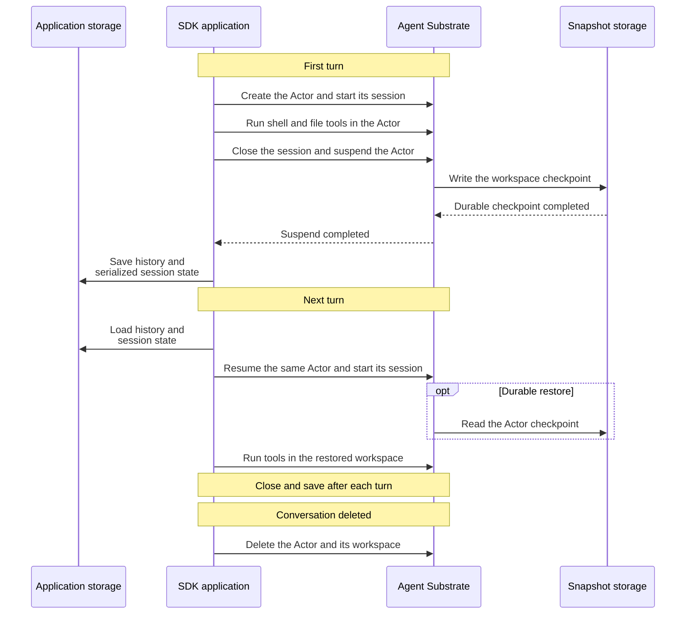

# Using the sandbox provider

- **Connect an SDK application to Substrate.** Set up cluster access, install
  the provider, and run the example with your own model. [Application integration](#integrate-into-your-application)
- **Try the provider without an API key.** Run the scripted check on a local
  Kind cluster or on a cluster you already operate. [Kind setup and test](local-kubernetes.md) · [Existing-cluster check](#run-the-provider-check-on-kubernetes)

## Integrate into your application

### 1. Prepare Substrate and cluster access

The example needs Substrate v1.0.0, `kubectl ate` on `PATH`, and the upstream
`sandbox-template` ActorTemplate in `ate-demo-sandbox`. Set up the cluster and
verify access to the template. [Existing-cluster setup](deployment.md#existing-substrate-cluster) · [Local Kind setup](local-kubernetes.md#set-up)

Set `SUBSTRATE_CONTEXT` to the Kubernetes context. Set
`SUBSTRATE_KUBECONFIG` when you use a separate kubeconfig. For the local Kind
cluster, run these exports from the repository root.

```sh
export PATH="$PWD/artifacts/local/bin:$PATH"
export SUBSTRATE_CONTEXT=kind-openai-agent-substrate
export SUBSTRATE_KUBECONFIG="$PWD/artifacts/local/kubeconfig"
```

### 2. Install the provider

Use your application's Python environment from the repository root. The
provider requires Python 3.11 or newer and pins `openai-agents==0.24.0`.

```sh
pip install ./sandbox
```

### 3. Run and resume an SDK agent

Your application keeps its `SandboxAgent`, model, and conversation state. Give
your existing `Runner.run` call a `RunConfig` with
`SandboxRunConfig(session=session)` from `SubstrateSandboxClient`. The provider
handles Actor lifecycle and sandbox execution.

Set `OPENAI_API_KEY` and `OPENAI_MODEL` in your application environment. Save
the example as `workspace_demo.py` and run `python workspace_demo.py`. It copies
a file with SDK sandbox tools, serializes the session to JSON after suspension,
then opens the same Actor and verifies the file survived.

```python
import asyncio
import json
import os
from pathlib import Path

from agents import Runner
from agents.run import RunConfig
from agents.sandbox import Manifest, SandboxAgent, SandboxRunConfig
from agents.sandbox.capabilities import Filesystem, Shell
from agents.sandbox.entries import File

from agent_substrate import (
    KubectlActorControl,
    SubstrateSandboxClient,
    SubstrateSandboxOptions,
)


async def run_workspace_round_trip(model):
    client = SubstrateSandboxClient(
        atespace="ate-demo-sandbox",
        control=KubectlActorControl(
            context=os.environ["SUBSTRATE_CONTEXT"],
            kubeconfig=os.getenv("SUBSTRATE_KUBECONFIG"),
        ),
    )
    content = b"hello from the Actor\n"
    report = Path("report.txt")
    manifest = Manifest(
        root="/workspace", entries={"input.txt": File(content=content)},
    )
    agent = SandboxAgent(
        name="Substrate workspace demo",
        model=model,
        instructions="Use the sandbox tools to copy input.txt to report.txt byte for byte.",
        capabilities=[Shell(), Filesystem()],
        default_manifest=manifest,
    )

    session = await client.create(
        manifest=manifest,
        options=SubstrateSandboxOptions(template="sandbox-template"),
    )
    try:
        async with session:
            await Runner.run(
                agent, "Copy input.txt to report.txt, then print the report.",
                run_config=RunConfig(
                    sandbox=SandboxRunConfig(session=session),
                    tracing_disabled=True,
                ),
            )
            with await session.read(report) as handle:
                saved_report = handle.read()
            if saved_report != content:
                raise RuntimeError("The agent did not copy input.txt exactly")

        # Leaving the scope suspends the Actor synchronously.
        actor_ref = f"{session.state.atespace}/{session.state.actor_name}"
        state_json = json.dumps(client.serialize_session_state(session.state))

        # Store this JSON in trusted application storage between turns.
        state = client.deserialize_session_state(json.loads(state_json))
        resumed = await client.resume(state)
        async with resumed:
            if f"{resumed.state.atespace}/{resumed.state.actor_name}" != actor_ref:
                raise RuntimeError("The resumed session points to a different Actor")
            with await resumed.read(report) as handle:
                if handle.read() != saved_report:
                    raise RuntimeError("The workspace file changed across resume")
        print(f"Resumed {actor_ref} with report.txt intact")
    finally:
        await client.delete(session)


if __name__ == "__main__":
    asyncio.run(run_workspace_round_trip(os.environ["OPENAI_MODEL"]))
```

The example deletes the Actor when it finishes. For a conversation, persist the
JSON in your application and delete the Actor when the conversation ends.
Store SDK conversation history or `RunState` alongside the Actor state so the
next run can restore both. [SDK conversation sessions](https://openai.github.io/openai-agents-python/sessions/)

## Choose how to retain a session

For a disposable run, pass `SandboxRunConfig(client=client, options=options)`
with `options = SubstrateSandboxOptions(template="sandbox-template")`. The SDK
creates and deletes the Actor, including when it returns an approval interruption.
The provider accepts the pinned SDK's default snapshot configuration and
`NoopSnapshotSpec` in this mode. Use an application-owned `session=` for approval
interruptions and durable cross-turn resume. [SDK lifecycle](https://openai.github.io/openai-agents-python/sandbox/guide/#sandbox-lifecycle)

For a workflow that can pause for approval, close the Actor session when the run
returns its interruption. Store the SDK run state and Actor state together in
trusted application storage. After an authorized approval, restore both states.
This example assumes one pending tool call.

```python
from agents import RunState

# After an application-owned run returns an interruption and its session closes.
approval_record = {
    "run_state": result.to_state().to_json(),
    "actor_state": client.serialize_session_state(session.state),
}

# Load the stored record after the application authorizes the approval.
pending = await RunState.from_json(agent, approval_record["run_state"])
pending.approve(pending.get_interruptions()[0])
resumed = await client.resume(client.deserialize_session_state(approval_record["actor_state"]))
async with resumed:
    result = await Runner.run(
        agent, pending, run_config=RunConfig(sandbox=SandboxRunConfig(session=resumed)),
    )
```

Persist both states again if the run pauses for another approval. Delete the
Actor when the workflow no longer needs its workspace.

Applications that must recover an allocation across process loss should use
`prepare_session_state()`, persist the returned state and template before
calling `create_from_state()`, and use `recover=True` with the same trusted,
provider-generated Actor identity after an uncertain create. A direct
`client.create()` attempts to remove a generated Actor when the create reply is
lost. If it cannot confirm cleanup, `ActorCreateUncertainError.actor_ref`
identifies the Actor to reconcile. If the create reply for an explicitly chosen
name is lost, that error leaves ownership and cleanup with the caller.

## Connect an in-cluster harness

The example client runs `kubectl ate` with your kubeconfig and reaches each
Actor through `kubectl ate proxy`. A harness in a pod calls Substrate as its own
ServiceAccount, using the volume provided by `substrate_volume()`.
[Credential projection](../deploy/kubernetes/base/README.md)

```python
from pathlib import Path
from agent_substrate import KubectlActorControl, RouterTLS, SubstrateSandboxClient

credentials = Path("/var/run/substrate")
client = SubstrateSandboxClient(
    atespace="ate-demo-sandbox",
    router_url="https://atenet-router.ate-system.svc",
    router_tls=RouterTLS(credential_bundle=credentials / "credential-bundle.pem",
                         ca_bundle=credentials / "router-ca.pem"),
    control=KubectlActorControl(context="in-cluster", kubeconfig="/etc/agent/kubeconfig",
                                endpoint="api.ate-system.svc:443",
                                token_file=credentials / "api-token"),
)
```

Lifecycle calls reach Substrate's API with the pod's token. Sandbox commands
reach the router over mutual TLS with the pod's certificate.
[In-cluster access grants](deployment.md#a-harness-in-the-cluster)

## Use one Actor per conversation

Create an Actor on the first message and store its serialized state alongside
the conversation history. Resume the same Actor for later messages and delete
it with the conversation. Serialize turns within a conversation so only one
turn uses its workspace at a time. Separate conversations can run concurrently.
[Shared ChatKit harness](agent-harness.md) · [Starter agent](../examples/starter/README.md) · [Workspace persistence](architecture.md#workspace-persistence-and-conversations)



Use `async with session, eviction_watch(client, session):` with
`eviction_watch` imported from `agent_substrate.eviction` for an
application-owned run on an eviction-aware image. If the worker reports a
drain, `ActorEvicted` interrupts the run and the outer session scope requests
synchronous suspend. When retaining an Actor, pass an async `persist` callback
that stores `client.serialize_session_state(session.state)`. The watcher calls
it before suspend. Store the updated state again after session close, including
after an interrupted turn. Resuming from a saved pending notice first retries
the synchronous checkpoint before reopening the Actor.
Rebuild and deploy the example sandbox image to enable eviction handling for
new conversations. Existing Actors keep their original image and template.
[Local deployment commands](local-kubernetes.md) · [Substrate eviction guidance](https://ate.dev/docs/reference/api-guide/#eviction)

The provider check shows how to carry `result.to_input_list()` into the next
run. [Provider check source](../examples/provider_check/main.py) · [Complete example applications](../examples/README.md)

## Run the provider check on Kubernetes

From the repository checkout, use a Substrate cluster with the upstream
`sandbox-template` ready. The check runs a scripted SDK agent, verifies that
its workspace survives suspend and resume, and deletes its Actor by default.
It runs without an OpenAI API key. [Deployment prerequisites](deployment.md)

```sh
uv run --locked python -m examples.provider_check \
  --backend substrate \
  --context YOUR_KUBERNETES_CONTEXT \
  --atespace ate-demo-sandbox \
  --template sandbox-template
```

The provider opens an authenticated loopback Actor proxy. Pass
`--kubeconfig PATH` for a separate cluster configuration. For live inference,
set `OPENAI_API_KEY` in your application environment and add `--model MODEL_ID`.
The check exports traces when you configure an OTLP endpoint.
[Tracing setup](tracing.md)

Add `--keep-actor` to retain the suspended Actor and save its state to
`artifacts/session.json`. It retains the workspace until you delete the Actor.

Inspect a retained Actor with the companion resume utility.

```sh
uv run python -m examples.provider_check.resume --context YOUR_KUBERNETES_CONTEXT --state-file artifacts/session.json
```

Pass the same `--kubeconfig` and `--atespace` used for creation when applicable.
Use `--command` to inspect artifacts, or `--delete` to remove the retained Actor.
