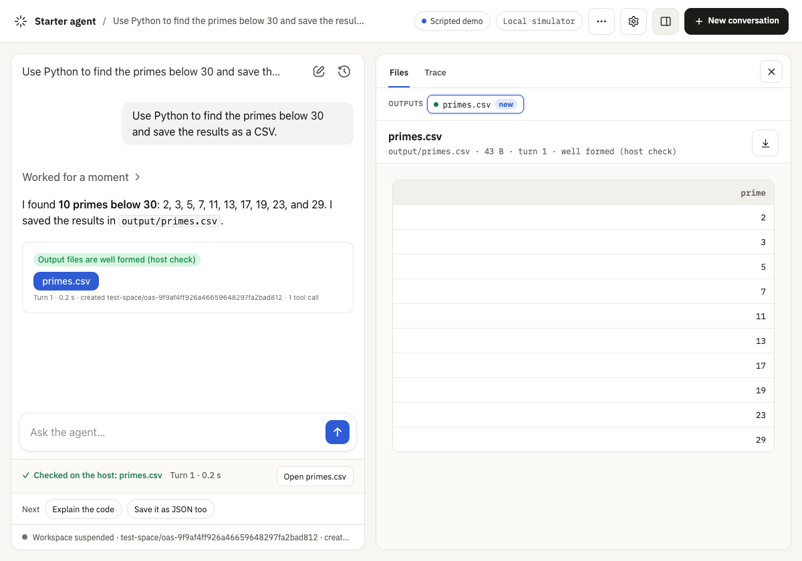
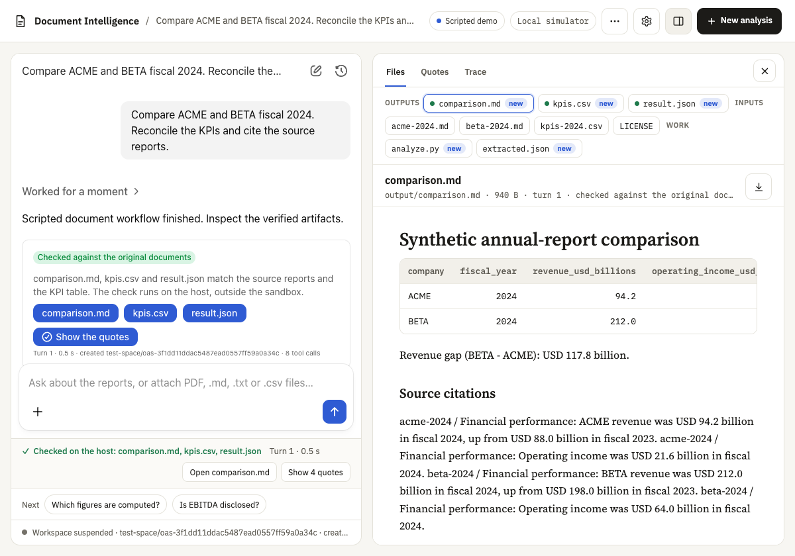
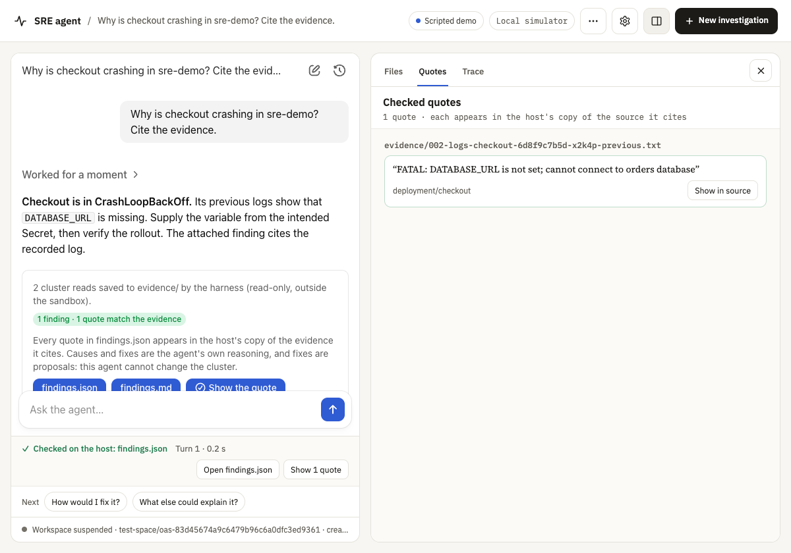

# Examples

Run examples from the repository root after `uv sync --locked`; the agents'
terminal chats and UIs also need `--group ui`, which installs the shared
harness (the `local-kubernetes.sh` commands pass it for you). They are source
applications and are not installed by the library wheel.

## Agent examples

The screenshots show scripted runs with sample data on the local protocol simulator.

### Starter agent

The smallest complete example on the shared harness, with terminal chat and an
optional UI. [Starter guide](starter/README.md)

### Document Intelligence

Loads a skill, reconciles source reports, and runs Python in the sandbox to
produce a cited comparison. Its ChatKit UI supports uploads, per-turn files, and
Jaeger traces. [Document Intelligence guide](document_intelligence/README.md) · [ChatKit UI](document_intelligence/ui/README.md)

### SRE agent

Investigates Kubernetes workloads with read-only tools in the harness. It
analyzes the evidence in the sandbox, then the harness verifies each cited
quote. [SRE guide](sre/README.md)

## Shared layout

The agents run on the [shared harness](../harness/README.md) at the repository
root, which runs the agent loop and gives each conversation its own sandbox.

Each agent keeps authored behavior in `agent/`, evaluations in `evals/`,
application deployment in `deploy/`, and its ChatKit UI in `ui/`, following
[Eve’s organization](https://eve.dev/docs/concepts/project-structure). In
`agent/`, `spec.py` is what the harness reads beside the `SandboxAgent`.
Reusable Kubernetes permissions and connection settings live in
[the base deployment](../deploy/kubernetes/base/README.md). `scripts/` contains
the shell bootstrap, which dispatches to the Python module CLIs, and the
execution server's build.

## Provider verification

The [provider check](provider_check/README.md) verifies execution, suspension,
session serialization, and resume without an API key. Use
`python -m examples.provider_check.resume` to inspect a retained Actor. See the
[session guide](../docs/usage.md) for state handling.
